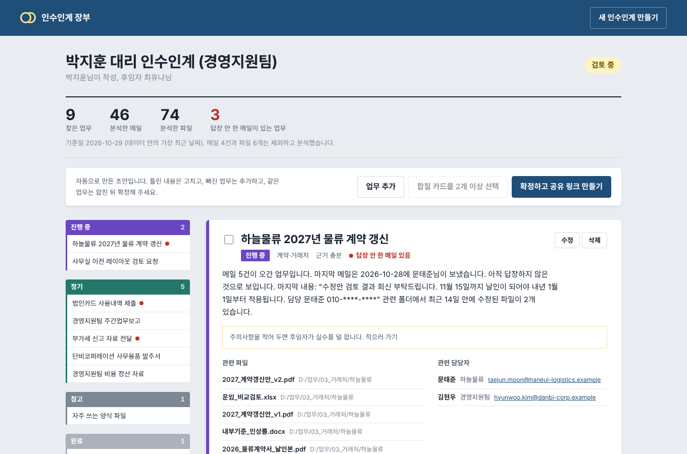
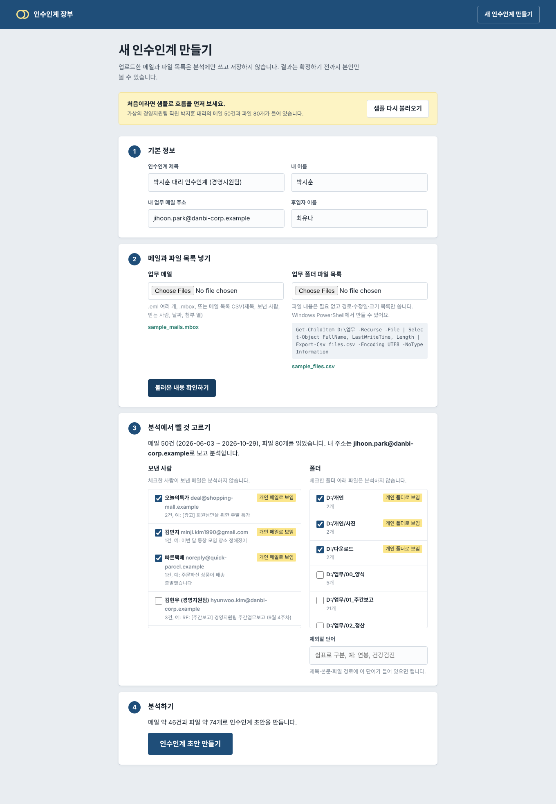
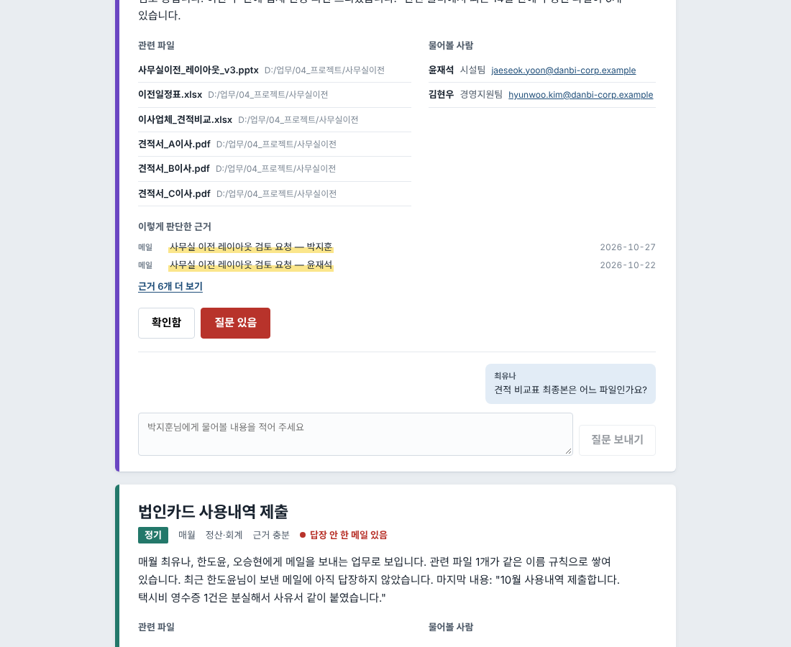

# 인수인계 장부 — 퇴사자 인수인계 초안 자동 생성기

퇴사(또는 부서 이동) 예정자가 **본인의 업무 메일과 업무 폴더 파일 목록**을 넣으면, 업무 흔적을 분석해
인수인계 리스트 초안을 만들어 주는 웹 앱입니다. 본인이 검토·수정·확정한 뒤 후임자에게 링크로 넘기고,
후임자는 업무마다 "확인함 / 질문 있음"을 체크하며 질문을 남길 수 있습니다.



## 설치 없이 바로 써 보기

**https://dhkdch1999.github.io/task1/** 에서 바로 열립니다.
또는 [`demo/index.html`](demo/index.html)을 내려받아 **더블클릭**해도 됩니다. Python이나 Node.js 설치가 필요 없습니다.
(저장소 루트의 `index.html`이 GitHub Pages 첫 화면이며, `python demo/build_demo.py`가 `demo/index.html`과 함께 만듭니다.)

1. **업무 메일**: `.eml`, `.mbox`, CSV 파일을 고르거나 끌어다 놓습니다. `.eml`이 든 폴더를 통째로 넣어도 됩니다.
2. **업무 폴더**: D드라이브의 업무 폴더를 통째로 고르거나 끌어다 놓습니다. 파일 내용은 열지 않고 이름·수정일·크기만 봅니다.
3. 개인 메일과 개인 폴더로 보이는 것은 자동으로 체크됩니다. 필요하면 체크를 바꿉니다.
4. **인수인계 초안 생성**을 누르면 업무 카드가 나옵니다. 고치고, 추가하고, 지운 뒤 **마크다운으로 복사**해서 문서나 메일에 붙여 넣습니다.

처음 열면 가상의 샘플 데이터가 들어 있어서 결과를 먼저 볼 수 있고, 내 파일을 넣으면 샘플은 자동으로 빠집니다.
샘플은 두 가지입니다. **다른 샘플 보기**로 바꿀 수 있어요.

| 샘플 | 인물 | 들어 있는 업무 | 파일 |
|---|---|---|---|
| 경영지원팀 사무직 | 박지훈 대리 | 주간보고, 비용정산·법인카드·사무용품 발주, 부가세, 물류 계약 갱신, 사무실 이전 | [`sample/`](sample) |
| 공작기계 제어개발 | 정우진 책임연구원 | 주간 진척 보고, 펌웨어 정기 릴리스, 필드 불량 리스트, 야간 빌드 알림, 고객사 채터링 이슈, EtherCAT 전환, 기능안전 문서, 서보드라이브 호환성 | [`sample/cnc/`](sample/cnc) |

`sample/cnc/제어개발_업무폴더.zip`은 압축을 풀면 실제 폴더 구조와 수정일이 그대로 나오므로,
**업무 폴더 고르기**로 폴더째 넣는 흐름을 그대로 시험할 수 있습니다. (파일 안에는 내용이 없습니다.)
분석은 모두 브라우저 안에서 끝나며 어디에도 전송하지 않습니다. 분석 규칙은 백엔드와 같으며(`demo/engine.js`),
샘플로 돌린 결과가 백엔드와 필드 하나까지 같은 것을 확인했습니다. 페이지를 고친 뒤에는 `python demo/build_demo.py`로 다시 만듭니다.

## 해결하려는 문제

- 인수인계서를 퇴사 직전에 몰아서 써서 누락이 많다
- 자료가 메일·폴더·메신저에 흩어져 있다
- "왜 이렇게 하는지", "누구에게 물어야 하는지" 같은 맥락이 빠진다
- 후임자는 무엇을 모르는지조차 몰라 질문을 못 한다

## 주요 기능

| 기능 | 내용 |
|---|---|
| 데이터 입력 | `.eml` 여러 개, `.mbox`, 메일 목록 CSV / 파일 목록 CSV(PowerShell 내보내기), 경로 목록 TXT |
| 분석 전 제외 | 개인 메일로 보이는 보낸 사람, 개인 폴더를 **미리 골라 체크**해 주고, 단어로도 뺄 수 있음 |
| 메일 분석 | 반복 주기(매주·매월·분기), 진행 중 스레드, 답장 안 한 메일, 업무 연락처 |
| 폴더 분석 | 파일명 날짜 패턴으로 반복 산출물, 최근 수정 파일, 여러 번 고친 핵심 문서, 양식 파일 |
| 교차 분석 | 첨부파일 ↔ 폴더 파일, 메일 제목 ↔ 폴더 이름을 연결 |
| 인수인계 카드 | 업무명·설명·주기·상태·관련 파일·담당자·주의사항, **판단 근거와 신뢰도** 표시 |
| 검토 | 카드 수정·삭제·추가·병합, 확정하면 공유 링크 생성 (확정 후에는 수정 잠금) |
| 후임자 화면 | 항목별 확인/질문, 질문·답변 스레드, 진행률 |

자세한 분석 규칙, 화면 구성, 데이터 구조는 [docs/DESIGN.md](docs/DESIGN.md)에 있습니다.

## 보안·개인정보 원칙

- 분석은 **본인이 직접 실행**합니다. 관리자가 남의 메일을 열람하는 기능은 없습니다.
- 업로드한 메일 원본과 본문은 **저장하지 않고** 정리된 결과만 저장합니다. (`tests/test_api.py::test_raw_mail_is_not_stored`로 확인)
- 결과에 남는 텍스트는 전화번호·주민번호·카드번호·이메일을 **가린 뒤** 저장합니다.
- 외부 서비스 호출이 없어 사내망에 그대로 설치할 수 있습니다. (웹폰트만 Google Fonts에서 받으며, 막혀 있으면 시스템 글꼴을 씁니다.)
- 이 저장소의 샘플 데이터는 모두 가상이며, 도메인은 `.example`을 씁니다.

> 회사 메일을 분석하는 도구는 회사 보안 정책과 개인정보 관련 법을 확인한 뒤 쓰세요.

## 실행하기

필요한 것: Python 3.10 이상, Node.js 18 이상

### 1. 백엔드 (FastAPI)

```bash
cd backend
python -m venv .venv
source .venv/bin/activate          # Windows: .venv\Scripts\activate
pip install -r requirements.txt
uvicorn app.main:app --reload --port 8000
```

API 문서: http://localhost:8000/docs

### 2. 프론트엔드 (React + TypeScript + Vite)

다른 터미널에서:

```bash
cd frontend
npm install
npm run dev
```

http://localhost:5173 을 열고 **"샘플 데이터로 먼저 보기"**를 누르면 가상의 직원(경영지원팀 박지훈 대리)의
메일 50건과 파일 80개로 전체 흐름을 바로 체험할 수 있습니다.

### 한 서버로 실행하기

```bash
cd frontend && npm run build      # frontend/dist 생성
cd ../backend && uvicorn app.main:app --port 8000
```

백엔드가 `frontend/dist`를 찾아 함께 서빙하므로 http://localhost:8000 하나로 접속합니다.

## 테스트

```bash
cd backend
pytest
```

분석 결과가 샘플에 심어 둔 업무(주간보고 매주, 비용정산·법인카드·사무용품 매월, 부가세 분기,
진행 중인 계약 갱신과 사무실 이전, 완료된 장비 세팅)와 맞는지, 개인 메일이 카드가 되지 않는지,
원본이 저장되지 않는지, 확정·공유·질문·답변 흐름이 동작하는지 확인합니다.

```bash
cd frontend
npm run typecheck
```

## 내 데이터로 써 보기

**파일 목록 만들기 (Windows PowerShell)**

```powershell
Get-ChildItem D:\업무 -Recurse -File | Select-Object FullName, LastWriteTime, Length | Export-Csv files.csv -Encoding UTF8 -NoTypeInformation
```

**메일 내보내기**

- Outlook: 메일을 바탕화면으로 끌어 놓으면 `.msg`가 되는데, 이 앱은 `.eml`/`.mbox`/CSV를 읽습니다.
  Thunderbird 등으로 `.mbox`를 만들거나, 메일 목록을 CSV(제목, 보낸 사람, 받는 사람, 날짜, 첨부 열)로 정리해 올려 주세요.
- Gmail: Google 테이크아웃에서 `.mbox`로 받을 수 있습니다.

업로드 형식 예시는 [`sample/`](sample) 폴더의 `sample_mails.mbox`, `sample_files.csv`를 참고하세요.

## 폴더 구조

```
backend/
  app/
    main.py          API (FastAPI)
    analyzer.py      메일·폴더·교차 분석 → 카드 초안
    parsers.py       .eml / .mbox / CSV / 파일 목록 파서
    privacy.py       개인정보 마스킹, 분석 제외 필터, 개인 메일·폴더 추천
    db.py            SQLite 저장소
    models.py        요청·응답 스키마
    sample_data.py   가상 샘플 1: 경영지원팀 (python -m app.sample_data)
    sample_cnc.py    가상 샘플 2: 공작기계 제어개발 (python -m app.sample_cnc)
  tests/             pytest
frontend/
  src/
    pages/           Home, NewHandover, Review(전임자), Successor(후임자)
    components.tsx   카드 표시 공용 컴포넌트
    CardEditor.tsx   카드 편집 폼
    api.ts, types.ts
    styles.css       디자인 토큰과 스타일
demo/
  index.html         설치 없이 여는 단독 실행 페이지 (build_demo.py로 생성)
  engine.js          브라우저용 분석 엔진 (backend 분석 규칙과 동일)
  template.html      단독 페이지 화면
  build_demo.py      template + engine + 샘플 → index.html
sample/              업로드 테스트용 가상 데이터
docs/                설계 문서, 스크린샷
```

## 기술 스택

- 백엔드: Python, FastAPI, SQLite
- 프론트엔드: React 19, TypeScript, Vite, 일반 CSS (디자인 토큰은 `styles.css` 맨 위)
- 분석: 규칙 기반(통계·패턴). LLM은 쓰지 않으며, 붙일 경우 전송 전에 `privacy.mask_pii`를 거치도록 설계했습니다.

## 다음 단계

- Word·PDF·엑셀 내보내기
- 로그인과 권한(공유 링크 대신 사내 계정으로 후임자 지정)
- 사내 승인된 LLM으로 업무 설명 다듬기
- Outlook `.msg`, `.pst` 직접 읽기

<p>
  
  
</p>
